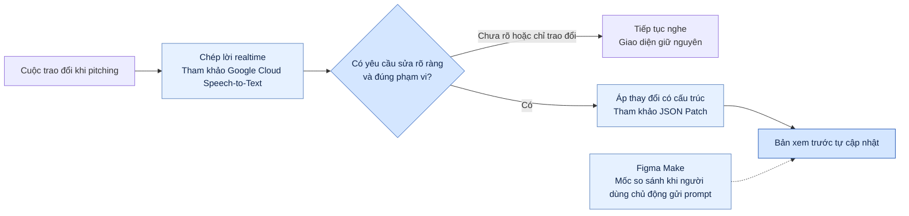

# Báo cáo nhóm — Day 02 Discovery & Problem Framing

## 1. Thông tin nhóm

- Tên nhóm: Delta
- Thành viên: [Lê Phạm Thành Đạt, Cao Trung Hiếu, Cao Thanh Tùng và Trần Đức Duy](../../TEAM.md#thành-viên).
- Đề tài đã chọn: Cập nhật MVP realtime.
- Vấn đề nhóm chọn: Khi khách góp ý trong buổi pitch, nhóm chưa thể cập nhật giao diện ngay, nên phải chỉnh sửa nội bộ rồi có thể phải hẹn thêm buổi để khách xem và xác nhận bản sửa.
- Quyết định cuối: **Go thử nghiệm Workflow nội bộ trong 1 tháng**, sau khi vượt bộ kiểm tra kỹ thuật trên màn hình Lịch tư vấn. Mục tiêu là còn **1 vòng chỉnh sửa/MVP** và giảm **30–40% thời gian triển khai MVP**. [Phạm vi và ngưỡng dừng](#8-quyết-định-cp6)

---

## 2. Hội tụ nhóm (CP3)

### 2.1. Pitch

Bảng tổng hợp 12 card từ báo cáo cá nhân. Cột cuối ghi câu hỏi dùng để đánh giá từng ứng viên.

| # | Người đưa ra | Candidate (Job Story ngắn) | Actor | Bottleneck | Câu hỏi rà soát |
| ---: | --- | --- | --- | --- | --- |
| 1 | Đạt | Khi kiểm hồ sơ HR, cần tìm mục lệch giữa bản giấy và bản mềm để bổ sung đúng chỗ. | Nhân sự phụ trách hồ sơ | Đối chiếu từng cặp bản. Khoảng một ngày tính cho cả đợt. | Tìm hồ sơ, đối chiếu hay bổ sung mất thời gian nhất? |
| 2 | Đạt | Khi đăng ký nhiều sự kiện, cần xem lại tên và giờ để sắp lịch. | Người đăng ký sự kiện | Tìm lại thông tin của 4 sự kiện. | Tra lại lịch mất bao lâu? Đã bỏ lỡ sự kiện nào chưa? |
| 3 | Đạt | Khi thông báo thực tập chưa rõ, cần biết câu trả lời và mốc cập nhật để chuẩn bị. | Sinh viên chuẩn bị thực tập | Khoảng hai tháng chờ thông báo kế tiếp. | Thông báo mới đã giải đáp câu hỏi ban đầu chưa? |
| 4 | Hiếu | Sau họp khách hàng, cần cô đọng quyết định và việc cần làm để gửi nhóm. | BA | Đọc lại và cô đọng ghi chú sau họp. | Mốc khoảng 30 phút gồm đọc lại, viết hay cả hai? |
| 5 | Hiếu | Khi khách góp ý về MVP, cần cho khách thấy bản sửa sớm để xác nhận đúng ý. | Người phụ trách demo MVP | Ước tính 15–20 phút trao đổi lại và cập nhật mỗi vòng. | Buổi nào chỉ hẹn lại để xem bản sửa nhỏ, buổi nào vì yêu cầu còn chưa rõ? |
| 6 | Hiếu | Khi xây hồ sơ trên nhiều nền tảng, cần chuẩn bị nội dung nhất quán để thể hiện đúng thế mạnh. | Người xây hồ sơ cá nhân | Tìm hiểu từng nền tảng, khoảng một tuần theo card. | Phần nào lặp lại giữa các nền tảng và phần nào cần tự tìm hiểu? |
| 7 | Tùng | Trước khi nộp lab, cần soát tên tệp, cấu trúc và tiêu chí để tránh lỗi. | Học viên hoặc nhóm học viên | Soát mục còn thiếu và đối chiếu rubric, khoảng 10–12 phút theo card. | Checklist hoặc Rule đã xử lý được những lỗi nào? |
| 8 | Tùng | Khi ghép bài của nhiều thành viên, cần tìm mâu thuẫn số liệu và ý lặp để biên tập bản chung. | Người tổng hợp báo cáo | Soát mâu thuẫn và chỉnh giọng văn, khoảng 30–40 phút theo card. | Bảng số liệu chung có tránh được mâu thuẫn từ đầu không? |
| 9 | Tùng | Khi cần tra lại hướng dẫn học tập, cần tìm đúng câu trả lời cũ để làm đúng yêu cầu. | Học viên | Cuộn tin nhắn khi từ khóa không khớp, khoảng 8–12 phút theo card. | Trường hợp nào có thể giải quyết bằng FAQ ghim đầu kênh? |
| 10 | Duy | Cuối kỳ, cần nắm quá trình học của từng em để viết nhận xét riêng. | Giáo viên bộ môn | Nhớ lại và tổng hợp thông tin từng em. Khoảng ba buổi tối cho cả đợt theo card. | Dữ liệu nào đã được ghi lại và dữ liệu nào chỉ có trong trí nhớ? |
| 11 | Duy | Khi chấm tự luận nhiều lớp, cần chấm kịp để trả bài khi học sinh còn nhớ nội dung. | Giáo viên bộ môn | Đọc và cho điểm. Khoảng 4 phút mỗi bài cho cả quy trình theo card. | Bao nhiêu thời gian dành cho đọc bài và bao nhiêu cho quyết định điểm? |
| 12 | Duy | Khi có điểm, cần chuyển từ sổ lên hệ thống đúng hạn và hạn chế nhập nhầm. | Giáo viên bộ môn | Gõ tay khoảng 160 điểm mỗi lượt theo card. | Hệ thống hiện tại có nhập từ bảng tính được không? |

Trong báo cáo cá nhân, Hiếu ghi nhận nhóm khác chất vấn giá trị của cách cập nhật MVP bằng AI. Phản hồi này dẫn đến việc phân biệt thay đổi nhỏ có thể thử ngay và thay đổi chức năng cần phân tích trước. Bản thử của Delta giới hạn ở thay đổi nhỏ trên bản xem trước. [Nhật ký và reflection của Hiếu](../individual/2A202603993_CaoTrungHieu.md)

### 2.2. Cluster

| Cluster | Các candidate | Pattern chung |
| --- | --- | --- |
| A — Tổng hợp và đối chiếu | #1, #4, #8, #10 | Thông tin nằm ở nhiều nguồn. Người làm phải tìm và đối chiếu rồi mới quyết định. |
| B — Theo dõi và xác nhận bước tiếp theo | #2, #3, #5, #9 | Lịch, phản hồi hoặc hướng dẫn chưa sẵn có đúng lúc, khiến người dùng phải tra lại, chờ hoặc hẹn lại. |
| C — Thao tác lặp và kiểm soát sai sót | #6, #7, #11, #12 | Thao tác lặp trên nhiều nền tảng, tệp hoặc bản ghi. Kết quả cuối vẫn cần chính xác. |

### 2.3. Opportunity Solution Tree rút gọn

Từ ba cụm trên, cây dưới đây thu hẹp vào tình huống MVP được chọn.

```text
OUTCOME: Giảm số vòng chỉnh sửa từ lúc nhận góp ý đến lúc xác nhận bản sửa MVP.
├── Hiểu đúng khách muốn đổi phần nào và muốn đổi ra sao.
├── Có bản sửa nhỏ để xem khi hai bên vẫn đang trao đổi.
└── Biết ngay bản sửa đã đúng ý hay còn cần làm rõ.
```

Các ý “chép lời realtime”, “dùng AI để hiểu yêu cầu” và “tự áp thay đổi” được đưa sang phần giải pháp để so sánh sau.

### 2.4. Chấm điểm shortlist (1–5)

Điểm dưới đây là đánh giá theo từng ứng viên, dựa trên nội dung các card.

| Candidate | Actor rõ | Quy trình rõ | Pain có bằng chứng | Impact đo được | Vừa sức lab | So sánh được No AI/Rule/Workflow/Agent | Nhóm hiểu domain | Tổng |
| --- | ---: | ---: | ---: | ---: | ---: | ---: | ---: | ---: |
| #5 — Vòng sửa giao diện MVP | 5 | 5 | 3 | 5 | 5 | 5 | 4 | **32** |
| #7 — Rà soát bài nộp lab | 5 | 5 | 3 | 5 | 5 | 3 | 5 | **31** |
| #10 — Viết nhận xét cuối kỳ | 5 | 4 | 3 | 4 | 3 | 4 | 3 | **26** |

**Ứng viên được chọn.** [Problem Card #2 của Hiếu](../individual/2A202603993_CaoTrungHieu.md#problem-card-2). Vòng lặp có điểm bắt đầu và kết thúc rõ, từ lúc khách góp ý đến lúc xác nhận bản sửa. Có thể thử một thay đổi nhỏ trên một màn hình và so sánh với cách sửa tay.

**Lý do chưa chọn hai ứng viên còn lại.** Với rà soát bài nộp, checklist và Rule đã có thể xử lý nhiều lỗi hình thức, nên giá trị tăng thêm của AI ở phần đó chưa rõ. Với nhận xét cuối kỳ, cần kiểm tra nguồn dữ liệu về từng học sinh và quyền sử dụng trước khi thử trên tình huống thật.

**Điều kiện ưu tiên.** Hai ứng viên đầu chênh một điểm. Nếu các buổi hẹn chủ yếu để chốt phạm vi, khả năng giảm số buổi hẹn bằng cách sửa giao diện tại chỗ sẽ thấp hơn.

### 2.5. Biên bản pitch và phản biện CP3

Đạt trình bày các card #1–3, Hiếu trình bày #4–6, Tùng trình bày #7–9. Duy tham gia phản biện. Người điều phối tóm tắt các card #10–12 của Duy để cả nhóm cân nhắc đủ 12 card. Bảng dưới ghi một lượt phản biện cho mỗi người.

| Người hỏi | Người trả lời | Câu hỏi phản biện | Điều chỉnh sau phản biện |
| --- | --- | --- | --- |
| Đạt | Hiếu | Trong các vòng chỉnh sửa, lần nào khách chỉ cần xem bản sửa nhỏ? Lần nào phải hẹn để chốt thêm yêu cầu? | Tách lý do hẹn lại thành hai nhóm. Chỉ tính buổi hẹn để xác nhận bản sửa nhỏ vào chỉ số cần giảm. |
| Hiếu | Tùng | Trong lần gần nhất rà bài lab, lỗi nào vẫn sót dù đã có checklist? | Tách lỗi tên tệp và cấu trúc khỏi lỗi nội dung. Đưa checklist và Rule vào đối chứng cho card #7. |
| Tùng | Hiếu | Sau khi khách nói xong, đến khi nào họ nhìn thấy bản sửa? Trong thời gian đó ai đang làm gì? | Tách thời gian thao tác khỏi thời gian chờ bàn giao và thời gian chờ khách xem. Đặt mốc bấm giờ chung ở CP5. |
| Duy | Hiếu | Trong một buổi trước đây, góp ý nào buộc nhóm đổi chức năng hoặc hỏi lại người phụ trách nghiệp vụ? | Thu hẹp phạm vi bản thử vào nhãn và vị trí của một nút. Ghi riêng yêu cầu về logic nghiệp vụ để người phụ trách xem xét. |

**Kết luận buổi pitch.** Giữ #5 làm ứng viên cần kiểm chứng trước vì có thể phân biệt được thời gian thao tác sửa và thời gian chờ xác nhận. #7 sát điểm nhưng còn phải chỉ ra phần checklist và Rule bỏ sót. #10 cần xác nhận có ghi chép đủ chi tiết về từng học sinh và có quyền sử dụng trước khi so sánh các phương án.

---

## 3. Kiểm chứng + research giải pháp đã có (CP4)

### 3.1. Assumption Map

| # | Nhận định cần kiểm chứng | Loại | Quan trọng (1–5) | Đã có bằng chứng (1–5) | Cách kiểm chứng |
| ---: | --- | --- | ---: | ---: | --- |
| 1 | Có buổi hẹn lại chỉ để khách xác nhận một thay đổi nhỏ trên giao diện. | Value | 5 | 2 | Dựng lại một MVP đã làm và phân loại lý do hẹn lại. |
| 2 | Đổi nhãn và vị trí nút là hai thao tác đủ để kiểm tra giả thuyết trong phạm vi lab. | Value | 4 | 2 | Đối chiếu với các góp ý thực tế. |
| 3 | Công cụ phân biệt được yêu cầu rõ với câu hỏi, phủ định và yêu cầu đã rút lại. | Feasibility | 5 | 1 | Chạy bộ 20 tình huống bằng lời nói. |
| 4 | Bản sửa đúng xuất hiện trong 10 giây từ lúc người nói kết thúc câu. | Feasibility | 4 | 1 | Bấm giờ trong bộ thử. |
| 5 | Người trình bày nhận ra bản sửa sai và khôi phục được trong buổi demo. | Usability | 5 | 1 | Thử thao tác quay lại với người điều khiển demo. |
| 6 | Nhóm có thể xử lý âm thanh và vận hành trong giới hạn chi phí và quyền sử dụng dữ liệu. | Viability | 4 | 1 | Đo chi phí nội bộ. Xác nhận quyền xử lý âm thanh trước khi thử với khách. |

Ưu tiên mục 1 để xác định buổi hẹn nào có thể giảm nhờ sửa tại chỗ. Các mục 3–5 là điều kiện để đưa bản thử vào buổi pitch mô phỏng.

### 3.2. Kiểm chứng

[Problem Card #2 của Hiếu](../individual/2A202603993_CaoTrungHieu.md#problem-card-2) và [slide nhóm](../assets/cp4-cac-vong-chinh-sua-mvp.html#slide-2) là cơ sở để soạn câu hỏi khảo sát. Cả hai cùng mô tả một tình huống nội bộ.

#### 3.2.1. Khảo sát nhanh

**Cách khảo sát.** Trong đợt diễn tập ngày 08–09/11/2026, khảo sát trực tuyến được gửi cho 10 người ngoài nhóm đã từng trình bày, hỗ trợ hoặc xem demo MVP. Có **8 phản hồi hợp lệ trên 10 lời mời, tương đương 80%**. Hai người không phản hồi. Mỗi người trả lời về lần góp ý gần nhất trong 30 ngày trước khảo sát. Bảng hỏi dùng mã và vai trò, không thu họ tên.

**Câu hỏi khảo sát**

1. Trong 30 ngày qua, có bao nhiêu buổi demo mà khách góp ý sửa giao diện?
2. Lần gần nhất, khách yêu cầu thay đổi gì? Nhóm xử lý ngay trong buổi hay chuyển việc cho người khác?
3. Bước nào mất thời gian nhất? Khách thấy và xác nhận bản sửa lúc nào?
4. Nếu có buổi hẹn lại, buổi đó dùng để xác nhận bản sửa hay để chốt yêu cầu mới?
5. Dựa trên ảnh hưởng của lần đó đến công việc, bạn đánh giá mức độ cần xử lý từ 1 đến 5 thế nào? Mức 1 là ít ảnh hưởng, mức 5 là làm chậm bước tiếp theo.

| Mã | Vai trò | Số buổi có góp ý / 30 ngày | Trải nghiệm gần nhất và cách xử lý | Kết quả xác nhận | Mức độ / 5 |
| --- | --- | ---: | --- | --- | ---: |
| P01 | Người trình bày prototype | 3 | Khách yêu cầu đưa nút lên đầu. Người trình bày thiếu quyền chỉnh nên chuyển cho designer. Bước chờ bàn giao và chờ khách xem chiếm phần lớn thời gian. | Khách xác nhận qua chat sau 92 phút, không hẹn lại. | 4 |
| P02 | BA | 2 | Khách yêu cầu đổi nhãn CTA. Nhóm ghi chú, sửa sau buổi và gửi lại bản xem trước. | Hẹn lại 10 phút sáng hôm sau chỉ để xác nhận bản sửa. | 4 |
| P03 | Người phụ trách demo | 4 | Khách muốn dời nút xác nhận lên đầu. Người có quyền sửa vắng mặt, nên nhóm ghi yêu cầu để bàn giao sau phiên. | Hẹn lại cuối ngày để xem bản sửa nhỏ. | 5 |
| P04 | Designer hỗ trợ demo | 3 | Khách muốn đổi nhãn nút. Designer mở sẵn bản chỉnh, sửa tại chỗ và làm mới preview sau 50 giây. | Xác nhận ngay trong phiên ở giây 65. | 2 |
| P05 | Kỹ sư phụ trách prototype | 2 | Khách muốn đổi vị trí nút. Kỹ sư chỉnh trực tiếp trên bản xem trước trong khoảng hai phút. | Xác nhận ngay trong phiên. | 2 |
| P06 | Người phụ trách sản phẩm phía khách | 2 | Góp ý liên quan đến quyền đổi lịch và quy tắc gửi thông báo. Bước chờ người phụ trách nghiệp vụ duyệt mất nhiều thời gian nhất. | Hẹn hôm sau để chốt nghiệp vụ. | 4 |
| P07 | Điều phối dự án | 1 | Khách yêu cầu đổi luồng duyệt. Nhóm ghi vào backlog và hỏi lại hai bên về phạm vi. | Hẹn lại để chốt luồng xử lý. | 3 |
| P08 | Người xem demo | 1 | Người xem hỏi nút ở đâu. Người trình bày chỉ vị trí trên màn hình và tiếp tục demo. | Không phát sinh yêu cầu sửa. | 1 |

**Kết quả.** Có **3/8 (37,5%)** phản hồi mô tả khách phải chờ sang sau phiên để xác nhận một thay đổi giao diện nhỏ. Trong đó, **2/8** phải hẹn thêm buổi chỉ để xem bản sửa, còn **1/8** xác nhận qua chat. Hai người đã sửa tay và xác nhận được ngay trong phiên. Hai người hẹn lại để chốt nghiệp vụ. Một lượt chỉ hỏi về hiện trạng. Tỷ lệ phản hồi tính trên 10 lời mời. Tỷ lệ gặp từng tình huống tính trên 8 phản hồi.

#### 3.2.2. Tình huống đối chiếu

| ID, vai trò | Thời điểm và cách hỏi | Câu hỏi về hành vi | Hành vi, cách xử lý và tín hiệu |
| --- | --- | --- | --- |
| S1 — Người trình bày prototype cho khách | 07/11/2026, gọi video 12 phút | “Lần gần nhất khách muốn chuyển nút lên đầu màn hình, bạn làm gì ngay trong buổi? Khách xem lại lúc nào?” | Người trình bày ghi yêu cầu rồi chuyển cho designer vì không có quyền chỉnh bản xem trước. Designer sửa 7 phút. Khách mở bản sửa sau 90 phút tính từ lúc nói xong và xác nhận sau 92 phút. Khách xác nhận qua chat trong ngày, không cần đặt thêm cuộc họp. |
| S2 — Người phụ trách sản phẩm phía khách | 08/11/2026, trao đổi trực tiếp 10 phút | “Buổi hẹn lại gần nhất để xem MVP, mọi người đã dành thời gian làm gì? Ai phải xác nhận thay đổi?” | Buổi sau diễn ra vào ngày hôm sau để chốt ai được sửa lịch và khi nào hệ thống gửi thông báo. Người phụ trách nghiệp vụ phải duyệt trước khi nhóm làm tiếp. Đây là tín hiệu phản bác việc quy tất cả các buổi hẹn lại cho chậm sửa giao diện. |
| S3 — Designer trực tiếp hỗ trợ demo | 09/11/2026, gọi thoại 11 phút | “Lần gần nhất khách muốn đổi chữ trên một nút, từ lúc nghe yêu cầu đến khi khách thấy bản sửa đã diễn ra thế nào?” | Designer đã mở sẵn bản chỉnh sửa và có quyền thao tác. Họ đổi nhãn, làm mới bản xem trước trong 50 giây rồi nhận xác nhận ngay trong phiên ở giây 65. Trường hợp này cho thấy sửa tay vẫn có thể đáp ứng ngay trong phiên. |

**Điều chỉnh phạm vi và chỉ số.** S1, S2 và S3 minh họa lại P01, P06 và P04, nên tổng vẫn là 8 phản hồi. Các lượt sửa tay tại chỗ là tín hiệu phản bác nhu cầu tự động hóa trong mọi buổi demo. Các buổi hẹn để chốt nghiệp vụ cần theo dõi riêng. Phạm vi thu hẹp còn yêu cầu rõ về nhãn hoặc vị trí nút. Chỉ số theo dõi gồm **thời gian từ lúc kết thúc lời góp ý đến lúc bản sửa xuất hiện**, **tỷ lệ xác nhận ngay trong phiên** và **số buổi hẹn lại chỉ để xem bản sửa nhỏ**. Khi thử, dùng sửa tay tại chỗ làm đối chứng. Kết quả chỉ phản ánh 8 phản hồi trong đợt diễn tập.

### 3.3. Research giải pháp đã có

| Công cụ / case / pattern | Link | Giải bước nào trong quy trình? | Điểm mạnh | Khoảng trống / rủi ro | Bài học cho nhóm |
| --- | --- | --- | --- | --- | --- |
| Google Cloud Speech-to-Text | [Streaming recognition](https://docs.cloud.google.com/speech-to-text/docs/streaming-recognize) và [kết quả tạm thời, kết quả cuối](https://docs.cloud.google.com/speech-to-text/docs/v1/speech-to-text-requests#streaming_speech-to-text_api_recognition_requests) | Chuyển lời nói trong buổi pitching thành văn bản. | Trả kết quả trong lúc nhận âm thanh và phân biệt bản chép tạm với kết quả cuối. | Văn bản chưa cho biết câu nào là yêu cầu sửa. Kết quả tạm có thể thay đổi khi người nói nói tiếp. | Chỉ đưa đoạn nhận dạng cuối vào bước phân loại yêu cầu. Đo độ trễ từ lúc người nói kết thúc câu đến lúc giao diện đổi. |
| Figma Make | [Chỉnh sửa tệp Figma Make](https://help.figma.com/hc/en-us/articles/42009840449175-Edit-a-Figma-Make-file) và [FAQ](https://help.figma.com/hc/en-us/articles/31722591905559-Figma-Make-FAQs) | Dùng prompt hoặc công cụ chỉnh sửa để thay đổi bản xem trước. | Tài liệu mô tả cập nhật preview khi người dùng gửi prompt và có hỗ trợ nhập prompt bằng giọng nói. | Luồng được tài liệu mô tả bắt đầu từ một prompt hoặc thao tác chỉnh sửa có chủ đích. Nguồn chưa xác nhận khả năng tự phát hiện yêu cầu trong cuộc hội thoại rồi áp dụng ngay. | Dùng làm mốc so sánh với phương án có người nhập yêu cầu. Thử xem tự nhận yêu cầu có giảm thao tác mà vẫn giữ đúng ý khách hay không. |
| JSON Patch (RFC 6902) | [RFC 6902, mục 4–5](https://www.rfc-editor.org/rfc/rfc6902.html#section-4) | Áp thay đổi có cấu trúc lên trạng thái bản xem trước nếu giao diện biểu diễn được bằng JSON. | Cho phép sửa đúng trường và kiểm tra giá trị hiện tại trước khi áp dụng. | Chuẩn chỉ mô tả thao tác trên dữ liệu. Nhóm vẫn cần ánh xạ yêu cầu nói thành phần tử giao diện, kiểm tra phạm vi và lưu bản trước khi sửa. | Thử trên một màn hình, với thao tác đổi nhãn hoặc vị trí nút đã định sẵn. Giữ bản trước để có thể khôi phục nếu kết quả sai ý. |

#### Sơ đồ khoảng trống cần thử nghiệm

Sơ đồ nối các bước tham khảo thành luồng đề xuất cho **một màn hình MVP**. Các công cụ trong bảng là nguồn đối chiếu cho từng bước.



**Điểm cần kiểm chứng.** Chuyển lời nói thành văn bản và áp thay đổi có cấu trúc là hai bước có tài liệu tham khảo. Phần cần thử là liệu hệ thống có nhận đúng **ý định sửa giao diện trong cuộc trao đổi tự nhiên** và áp dụng đủ nhanh để bản sửa xuất hiện ngay trong lúc pitching.

**Tình huống để bàn giao cho CP5–CP6**

- **Yêu cầu rõ:** Khách nói “Đưa nút Đặt lịch lên đầu màn hình”. Bản xem trước tự đổi đúng vị trí. Đo từ lúc khách nói xong đến lúc nút xuất hiện ở vị trí mới.
- **Trao đổi thông thường:** Khách hỏi “Nút Đặt lịch hiện nằm ở đâu?”. Giao diện giữ nguyên.
- **Yêu cầu mơ hồ:** Khách nói “Chỗ này nhìn chưa ổn”. Công cụ tiếp tục nghe cho đến khi xác định được phần tử và thay đổi cụ thể.

**Bàn giao kiểm thử.** [Bộ 20 tình huống cho bản thử](../assets/cp4-bo-tinh-huong-mvp.md) có trạng thái ban đầu, kết quả mong đợi và bảng ghi thời gian theo từng lượt.

**Đối chiếu số liệu trước khi chốt baseline**

- [Problem Card #2 của Hiếu](../individual/2A202603993_CaoTrungHieu.md#problem-card-2) ghi khoảng **15–20 phút trao đổi lại và cập nhật mỗi vòng**, khoảng 2–3 vòng mỗi MVP. Tổng **30–60 phút** là ước tính cho phần trao đổi lại và cập nhật theo vòng, chưa tính thời gian thiết kế lại.
- [Slide Vấn đề](../assets/cp4-cac-vong-chinh-sua-mvp.html#slide-2) dùng ước tính khoảng **2 giờ cho toàn bộ một buổi pitching**, 2–3 buổi mỗi MVP, tức **4–6 giờ họp**. Con số **6–9 giờ** chỉ áp dụng nếu nhóm dành thêm khoảng **1 giờ chỉnh sửa nội bộ sau mỗi buổi**.
- Ở mục 3.2, ghi riêng tổng thời lượng buổi họp, số phút dành riêng cho việc làm rõ phản hồi, và số lần thực sự phải chỉnh sửa sau họp. Khi tính tổng, cộng thời lượng họp với thời gian chỉnh sửa nội bộ thực tế. Thời gian trao đổi đã nằm trong buổi họp cần được ghi riêng để tránh cộng hai lần.

---

## 4. Quy trình trước/sau (CP5)

### 4.1. Quy trình hiện tại

``` text
Khách góp ý trong buổi demo
→ Người phụ trách ghi lại và làm rõ thay đổi
→ Nhóm sửa nội bộ sau buổi họp
→ Gửi bản sửa hoặc hẹn buổi khác để trình bày
→ Khách xác nhận hoặc góp ý tiếp
```

| Bước | Actor | Input | Output | Thời gian / tần suất | Ghi chú |
| ---: | --- | --- | --- | --- | --- |
| 1. Nhận góp ý | Khách, người trình bày | Màn hình MVP đang demo | Góp ý về giao diện | Trong buổi pitch. Slide ước tính khoảng 2 giờ cho cả buổi. | Chưa có số phút riêng cho góp ý. |
| 2. Ghi và làm rõ | Người trình bày, nhóm dự án | Góp ý và ghi chú | Yêu cầu chỉnh sửa đã hiểu | Card ước tính 15–20 phút cho phần trao đổi lại và cập nhật mỗi vòng. | Ước tính gộp, chưa tách riêng bước 2. |
| 3. Sửa nội bộ | Người chỉnh prototype | Yêu cầu đã hiểu, bản hiện tại | Bản xem trước đã sửa | Slide phân tích trường hợp có khoảng một giờ sửa nội bộ sau mỗi buổi. | Cần đo riêng phần thực sự thao tác. |
| 4. Cho khách xem lại | Người trình bày | Bản xem trước đã sửa | Bản sửa được gửi hoặc trình bày lại | Trong hoặc sau buổi pitch, tùy thời điểm có bản sửa. | Ghi riêng các lần phải hẹn lại để khách xem. |
| 5. Xác nhận | Khách, người trình bày | Bản sửa | Xác nhận hoặc phản hồi mở vòng mới | Card ước tính 2–3 vòng cho mỗi MVP. | Chưa rõ bao nhiêu vòng chỉ để xem bản sửa nhỏ. |

**Điểm nghẽn.** Bước 3 và 4 nối tiếp nhau sau buổi pitch. Khách phải chờ đến khi nhóm có bản sửa để xác nhận, kể cả khi thay đổi chỉ là nhãn hoặc vị trí nút. Cần đo từ lúc yêu cầu được nêu đến lúc khách thấy bản sửa để tách thời gian thao tác khỏi thời gian chờ.

### 4.2. Quy trình tương lai

``` text
1. [Con người] Người trình bày bật chế độ thử và chọn màn hình Lịch tư vấn.
2. [AI] Chép lời, ghép các đoạn đã chốt và đợi hết lượt nói. Sau đó mới phân loại và trích thao tác, nút, giá trị mới.
3. [Rule] Kiểm tra yêu cầu rõ, đúng màn hình, đúng nút và thao tác được phép.
   ├─ Chưa rõ, ngoài phạm vi hoặc có lỗi → giữ nguyên; người trình bày làm rõ khi cần.
   └─ Hợp lệ → lưu bản trước, áp thay đổi lên bản xem trước và ghi kết quả.
4. [Con người] Đối chiếu bản sửa với ý khách và ghi nhận xác nhận.
   └─ Sai ý → khôi phục bản trước, tắt tự áp dụng và ghi yêu cầu để sửa tay.
```

**Phạm vi.** Bản thử chỉ tự áp thay đổi nhỏ, rõ ràng và trong danh sách cho phép, gồm nhãn hoặc vị trí đầu/cuối của nút Đặt lịch trên bản xem trước. Rule kiểm tra giá trị trước khi áp. Yêu cầu thay đổi lớn như sửa luồng người dùng hoặc logic nghiệp vụ được ghi lại để người phụ trách phân tích, duyệt và xử lý riêng. Công cụ không tự xuất bản, sửa tệp nguồn hoặc đổi màn hình khác.

Một đoạn nhận dạng đã chốt vẫn có thể chỉ là một phần của lượt nói. Cần đợi hết lượt trước khi áp thay đổi để xử lý trường hợp khách nói tiếp “khoan, giữ nguyên”. Kiểm tra điều này ở lượt B09. [Kết quả nhận dạng theo luồng](https://docs.cloud.google.com/speech-to-text/docs/v1/speech-to-text-requests#streaming_speech-to-text_api_recognition_requests)

### 4.3. Before / after

| Chỉ số | Trước | Sau (mục tiêu thử) | Cách đo / ghi chú |
| --- | --- | --- | --- |
| Số bước chính | 5 bước | 4 bước trên nhánh yêu cầu rõ | Đếm theo hai quy trình trên, gồm cả bước xác nhận. |
| Số bước có người thao tác | 5 bước | 2 bước chính trên nhánh hợp lệ | Bật chế độ thử một lần mỗi phiên và kiểm tra bản sửa. Nhánh làm rõ hoặc sửa tay được ghi riêng. |
| Thời gian từ lúc khách nêu yêu cầu đến lúc thấy bản sửa | 90 phút trong ca S1 của đợt diễn tập. Mốc 15–20 phút mỗi vòng của Card #2 tính phần trao đổi và cập nhật. | Bản sửa đúng xuất hiện trong tối đa 10 giây ở bản thử. | Cùng bấm giờ từ lúc kết thúc câu đến lúc bản xem trước hiện đúng. So với cách sửa tay trên cùng tình huống. |
| Số vòng chỉnh sửa/MVP | Ước tính 2–3 vòng/MVP theo card của Hiếu. | 1 vòng/MVP trong thử nghiệm nội bộ. | Đếm vòng theo lần nhận góp ý và đưa bản sửa ra xác nhận. Ghi riêng số buổi hẹn lại và lý do. |
| Thời gian triển khai MVP | Chưa có số đo tổng thời gian triển khai theo cùng cách tính. | Giảm 30–40% sau 1 tháng thử nội bộ. | Đối chiếu với MVP nội bộ tương đương triển khai theo cách cũ. Dùng cùng mốc bắt đầu và kết thúc. |
| Rủi ro trong thao tác | Hiểu sai phản hồi và chỉ phát hiện ở buổi sau. | Có thể hiểu sai câu nói và cập nhật trước mặt khách. | Kiểm tra câu phủ định, câu rút lại yêu cầu và khả năng khôi phục. |

### 4.4. Bấm giờ, bàn giao và so sánh trước/sau

Dựng lại ca S1 với yêu cầu **“Đưa nút Đặt lịch lên đầu màn hình”**. Nút bắt đầu ở cuối màn hình. Mốc 0 là lúc người nói kết thúc câu. Mỗi khoảng dưới đây nối tiếp khoảng trước. Thời gian họp diễn ra trước mốc 0 được loại khỏi phép tính.

| Bước hiện tại | Người làm | Đầu vào → đầu ra và bàn giao | Thao tác | Chờ | Mốc tích lũy |
| --- | --- | --- | ---: | ---: | ---: |
| 1. Tiếp nhận | Người trình bày | Câu góp ý → yêu cầu đã nghe, bắt đầu bấm giờ | 0 phút | 0 phút | 0 phút |
| 2. Ghi và bàn giao | Người trình bày | Câu góp ý → ghi chú tên màn hình, tên nút và vị trí mới. Chuyển cho designer | 1 phút | 0 phút | 1 phút |
| 3. Chờ và sửa nội bộ | Designer | Ghi chú và bản hiện tại → bản xem trước đã sửa. Trả link cho người trình bày | 7 phút | 39 phút | 47 phút |
| 4. Cho xem lại | Người trình bày, người xem demo | Link bản sửa → người xem mở và thấy nút ở đầu màn hình | 1 phút | 42 phút | 90 phút |
| 5. Xác nhận | Người xem demo, người trình bày | Bản xem trước → lời xác nhận được ghi vào nhật ký | 2 phút | 0 phút | 92 phút |
| **Tổng** | | | **11 phút** | **81 phút** | **92 phút** |

**Điểm nghẽn trong ca S1.** Phần chờ ở bước 3 và 4 chiếm 81/92 phút. Chỉ số **đến lúc thấy bản sửa** là 90 phút, còn **đến lúc xác nhận** là 92 phút. Một ca không đủ để suy ra mức trung bình cho cả nhóm.

| Bước tương lai | Ai làm | Đầu vào → đầu ra và bàn giao | Ngân sách thời gian |
| --- | --- | --- | --- |
| 1. Chuẩn bị trước phiên | Người trình bày | Màn hình Lịch tư vấn → bản xem trước đúng trạng thái, chế độ thử được bật | 15 giây trước mốc 0 |
| 2. Chốt bản chép và nhận diện | AI | Âm thanh cả lượt nói → bản chép cuối → yêu cầu đổi vị trí nút, chuyển cho Rule | 6 giây sau mốc 0, gồm cả thời gian chốt bản chép |
| 3. Kiểm tra và áp thay đổi | Rule | Yêu cầu có cấu trúc → bản sửa hợp lệ và bản trạng thái cũ để khôi phục | 2 giây, bản sửa xuất hiện ở giây 8 |
| 4. Đối chiếu và xác nhận | Người trình bày, người xem demo | Bản sửa → xác nhận đúng ý được ghi lại. Sai ý thì khôi phục, tắt tự áp dụng và chuyển sang ghi nhận | 45 giây, xác nhận ở giây 53 |

**Cách dùng bảng để chấm.** Bảng phân bổ 8 giây cho hai bước tự động, trong giới hạn 10 giây. Khi chạy thử, dùng cùng câu nói, trạng thái ban đầu và mốc bấm giờ cho Workflow và sửa tay tại chỗ. Ghi độ đúng, thời gian xuất hiện bản sửa và thời gian xác nhận cho mỗi lượt. Đánh giá tỷ lệ xác nhận trong phiên trên toàn bộ lượt, rồi so sánh thời gian xác nhận ở những lượt cả hai cách đều làm đúng. Với lượt cần giữ nguyên, ghi cả thay đổi xuất hiện thoáng qua. Chạy thêm một lượt khôi phục riêng.

**Cách tính chỉ số một tháng.** Lấy thời gian từ lúc bắt đầu triển khai đến lúc MVP được xác nhận để demo ở hai MVP nội bộ có phạm vi tương đương. Nếu đối chứng mất 10 giờ còn lượt thử mất 7 giờ thì mức giảm là 30%, bằng ngưỡng tối thiểu ở mục 8.2. Ghi số vòng góp ý → đưa bản sửa ra xác nhận cho từng MVP, chẳng hạn giảm từ 2 xuống 1 vòng.

---

## 5. Problem Statement v0 (CP5)

| Trường | Nội dung |
| --- | --- |
| **Actor** | Người phụ trách trình bày MVP và tiếp nhận phản hồi từ khách. |
| **Quy trình** | Demo → khách góp ý → nhóm làm rõ và chỉnh sửa → cho khách xem lại → xác nhận. |
| **Bottleneck** | Khoảng chờ giữa góp ý và bản sửa khách có thể xem. Việc sửa thường diễn ra sau buổi pitch. |
| **Impact** | Có thể phải thêm vòng làm rõ hoặc buổi trình bày, khiến việc xác nhận phiên bản MVP kéo dài. |
| **Success Metric** | Card của Hiếu ước tính 2–3 vòng/MVP và 15–20 phút trao đổi lại và cập nhật mỗi vòng. Mục tiêu ban đầu là còn 1 vòng/MVP. Đếm số vòng từ góp ý đến xác nhận và ghi thời gian từng vòng. |
| **Boundary** | Thử trên bản xem trước. Người trình bày xác nhận thay đổi với khách và xử lý yêu cầu chưa rõ hoặc vượt phạm vi. |

**Phản biện khi rà v0.** Mốc 2–3 vòng có thể bao gồm cả làm rõ yêu cầu và đổi phạm vi. V1 giữ mục tiêu 1 vòng/MVP từ card của Hiếu và ghi lý do phát sinh từng vòng để hiểu phần nào có thể giảm nhờ sửa tại chỗ. Chỉ số tốc độ và độ đúng của prototype được chấm riêng.

**Cách sửa v0 sau phản biện.** Câu hỏi phản biện là “Nếu khách đã thấy bản sửa nhưng còn cân nhắc, đồng hồ dừng ở lúc nào?” Tách hai mốc **bản sửa xuất hiện** và **khách xác nhận**. Success Metric của v0 ưu tiên thời gian đến lúc xác nhận và số lượt xác nhận trong phiên. Khi so sánh với sửa tay trên cùng yêu cầu, mục tiêu là rút ngắn thời gian xác nhận ở các lượt cả hai cách đều đúng và giữ tỷ lệ xác nhận trong phiên ít nhất bằng sửa tay. Thời gian xuất hiện bản sửa là chỉ số bổ sung để xác định phần chờ có thể giảm. Người trình bày chịu trách nhiệm xác nhận ý khách và chuyển yêu cầu đổi nghiệp vụ sang quy trình xét duyệt riêng.

---

## 6. Mức can thiệp AI (CP6)

### 6.1. Ma trận độ mơ hồ × độ phức tạp

**Độ mơ hồ cao, độ phức tạp thao tác thấp trong phạm vi thử.** Một câu có nhắc tên nút có thể là yêu cầu, câu hỏi, lời nhắc lại hoặc phủ định. Khi ý định đã rõ, chỉ có hai thuộc tính được sửa trên một nút. Các bước còn lại có thể định trước.

### 6.2. So sánh 4 mức

| Mức | Phương án | Đủ khi nào | Rủi ro | Vai trò trong bản thử |
| --- | --- | --- | --- | --- |
| **No AI** | Người trình bày xác nhận yêu cầu rồi đổi nhãn hoặc vị trí ngay trên bản xem trước. | Ít góp ý và có người chỉnh giao diện tại chỗ. | Người trình bày phải vừa nói vừa thao tác hoặc nhờ người khác. | Đối chứng và phương án quay về. |
| **Rule** | Dùng nút điều khiển hoặc lệnh có cú pháp cố định như “đổi nhãn thành …”. | Người dùng chấp nhận lệnh cố định và mục cần sửa đã rõ. | Luật theo từ khóa có thể nhầm câu hỏi hoặc phủ định với yêu cầu. | Kiểm phạm vi và thực thi thao tác hợp lệ. |
| **Workflow** | Chép lời → nhận diện ý định → Rule kiểm thao tác → cập nhật bản xem trước → con người xác nhận. | Khách nói tự nhiên, còn hành động và giới hạn được định sẵn. | Có thể nghe hoặc hiểu sai. Cần đo độ đúng, độ trễ và thử khôi phục. | **Chọn để thử nội bộ.** |
| **Agent** | Tự chọn màn hình, công cụ và chuỗi thao tác để sửa giao diện. | Yêu cầu trải qua nhiều màn hình hoặc cần tự lập kế hoạch. | Khó giới hạn và kiểm tra thay đổi trong buổi demo. | Ngoài phạm vi bản thử. |

**Lý do chọn Workflow.** No AI có thể đủ nếu thao tác tay vừa nhanh vừa chính xác. Rule dùng cú pháp cố định phù hợp khi người dùng chịu nói theo lệnh. Workflow cho phép thử xem việc hiểu lời nói tự nhiên có giảm thao tác mà vẫn giữ đúng ý khách hay không. Hai thao tác được phép có thể liệt kê trước nên chưa cần Agent.

### 6.3. AI Canvas rút gọn

| Thành phần | Nội dung |
| --- | --- |
| **Prediction** | Từ bản chép đã chốt của cả lượt nói, phân loại thành yêu cầu rõ, cần làm rõ hoặc giữ nguyên. Với yêu cầu rõ, trích thành phần, thuộc tính và giá trị mới. |
| **Judgment** | Người trình bày kiểm tra bản sửa có đúng ý khách. Nếu câu thiếu thông tin, hỏi lại phần tử hoặc giá trị còn thiếu. |
| **Action** | Rule kiểm phạm vi, lưu trạng thái cũ và chỉ áp thay đổi hợp lệ lên bản xem trước. Người trình bày xác nhận hoặc khôi phục. |
| **Outcome** | Trong thử nghiệm một tháng, đo số vòng chỉnh sửa/MVP và mức giảm thời gian triển khai so với cách cũ. Khi kiểm tra kỹ thuật và mô phỏng, đo độ đúng, số lần sửa nhầm, độ trễ và tỷ lệ xác nhận trong phiên. |
| **Input** | Âm thanh nói thử, bản chép cuối, màn hình đang hoạt động, nhãn và vị trí hiện tại. Nhóm đã có 20 câu tổng hợp và trạng thái ban đầu của từng lượt. |
| **Feedback** | Người quan sát ghi kết quả mong đợi, kết quả thấy được và thời gian. Khi sai, ghi lỗi do bản chép, hiểu ý hay áp thay đổi, rồi chạy lại sau khi sửa. |

### 6.4. Hai câu hỏi của Google PAIR

- **Hỗ trợ hay giao hẳn việc?** Thiết kế bản thử theo hướng hỗ trợ. Công cụ thực hiện thay đổi đã giới hạn. Người trình bày và khách vẫn chốt ý nghĩa của phản hồi và quyết định bản sửa đã đạt chưa. Card của Hiếu mô tả nhu cầu cho khách thấy bản sửa sớm, còn mức tự động hóa người dùng chấp nhận vẫn cần kiểm chứng.
- **Sai kiểu nào tệ hơn?** Sửa nhầm dễ làm gián đoạn buổi pitch vì khách thấy màn hình đổi dù chưa yêu cầu. Bỏ sót có thể xử lý bằng xác nhận lại rồi sửa tay. Luồng giữ nguyên khi chưa chắc, lưu bản trước và cho người trình bày tắt tự áp dụng.

---

## 7. Problem Statement v1 + tiêu chí đánh giá (CP6)

| Trường | Nội dung |
| --- | --- |
| **Actor** | Người trình bày MVP đang demo màn hình Lịch tư vấn cho khách. |
| **Quy trình** | Khách góp ý → người trình bày ghi nhận → nhóm sửa nhãn hoặc vị trí nút → khách xem và xác nhận. Khi chưa sửa tại chỗ, hai bước cuối có thể dời sang sau buổi pitch. |
| **Bottleneck** | Phải đợi nhóm sửa và đưa bản xem trước cho khách, kể cả khi thay đổi nhỏ đã rõ. |
| **Impact** | Nếu buổi hẹn tiếp theo chỉ để xem bản sửa, việc chờ bản sửa làm tăng thời gian chốt giao diện và số buổi cả hai bên phải sắp xếp. |
| **Success Metric** | **Sau 1 tháng thử nội bộ:** từ 2–3 vòng/MVP (ước tính của Hiếu) xuống 1 vòng/MVP và giảm 30–40% thời gian triển khai MVP so với cách cũ. Baseline thời gian triển khai cần đo theo mục 8.2. **Kiểm tra kỹ thuật trước khi thử:** ≥9/10 yêu cầu rõ sửa đúng, 0/10 trường hợp cần giữ nguyên bị sửa và mỗi lượt sửa đúng ≤10 giây. **Pitch mô phỏng:** so với sửa tay bằng tỷ lệ xác nhận trong phiên và thời gian đến lúc xác nhận. |
| **Boundary** | Chỉ tự đổi nhãn hoặc vị trí đầu/cuối của nút Đặt lịch trên bản xem trước. Câu hỏi, yêu cầu mơ hồ, phủ định, rút lại hoặc ngoài phạm vi giữ nguyên. Thay đổi lớn phải qua người phụ trách phân tích và duyệt trước khi xử lý riêng. |
| **AI intervention point** | Sau khi có bản chép đã chốt của cả lượt nói và trước bước Rule kiểm phạm vi. AI nhận diện ý định và đề xuất giá trị sửa. |
| **Mức chọn** | Workflow. |
| **Rủi ro và người kiểm tra** | Sai bản chép hoặc sai ý định có thể gây sửa nhầm. Người trình bày kiểm bản sửa ngay trong phiên, có quyền dừng và khôi phục. Một thành viên quan sát ghi sai lệch trong lúc thử. |

**Thay đổi so với v0**

| Trường | v0 | v1 | Lý do đổi |
| --- | --- | --- | --- |
| Phạm vi | Giao diện MVP nói chung trên bản xem trước. | Một nút, hai thuộc tính và danh sách trường hợp giữ nguyên. | Đủ hẹp để đặt kết quả mong đợi cho từng câu và xác định sửa nhầm. |
| Chỉ số | Mục tiêu còn 1 vòng chỉnh sửa/MVP. | Giữ mục tiêu 1 vòng/MVP, thêm mục tiêu giảm 30–40% thời gian triển khai sau 1 tháng. Tách bộ tiêu chí kỹ thuật và ghi lý do từng vòng. | Cần đo cả hiệu quả ở cấp MVP và chất lượng của từng lượt tự cập nhật. |
| Trách nhiệm | Người trình bày xác nhận bản sửa. | AI trích yêu cầu, Rule kiểm và áp, người trình bày xác nhận hoặc khôi phục. | Xác định chỗ phát sinh lỗi và người xử lý khi sai. |

**Tiêu chí đánh giá đầu ra**

| # | Tiêu chí | Đạt khi | Không đạt khi |
| ---: | --- | --- | --- |
| 1 | Đúng yêu cầu rõ | Ít nhất 9/10 lượt nhóm A đổi đúng nút, đúng thuộc tính và giá trị. Thuộc tính còn lại giữ nguyên. | Dưới 9/10 lượt đúng, kể cả trường hợp bỏ sót hoặc sửa thêm thuộc tính. |
| 2 | Giữ nguyên đúng lúc | Cả 10 lượt nhóm B giữ nguyên trong 10 giây quan sát sau khi nói xong. Thay đổi thoáng qua trong lượt cũng tính là sửa nhầm. | Có bất kỳ thay đổi nào trong một lượt nhóm B. |
| 3 | Độ trễ | Mỗi lượt A sửa đúng xuất hiện và ổn định trong tối đa 10 giây tính từ lúc người nói kết thúc câu. | Có lượt đúng nhưng vượt 10 giây. |
| 4 | Khôi phục | Trong một lượt thử riêng có thay đổi sai, người trình bày khôi phục đúng nhãn và vị trí trước đó, rồi chuyển sang chỉ ghi nhận. | Không khôi phục đủ trạng thái hoặc chế độ vẫn tự áp dụng. |

Đánh giá từng lượt theo ID của bộ kiểm thử.

---

## 8. Quyết định (CP6)

### 8.1. Bốn rủi ro

| Rủi ro | Mức | Lý do và cách kiểm tra |
| --- | --- | --- |
| **Value** | Cao | Card mô tả có nhiều vòng chỉnh sửa, nhưng chưa biết bao nhiêu buổi hẹn lại chỉ để xem bản sửa nhỏ. Dựng lại một MVP đã làm và ghi lý do từng buổi. |
| **Usability** | Trung bình | Thao tác sai có thể làm gián đoạn buổi pitch. Thử việc nhận ra bản sửa, tắt tự áp dụng và khôi phục ngay trên bản xem trước. |
| **Feasibility** | Trung bình | Chép lời và cập nhật có tài liệu tham khảo. Độ đúng khi nhận diện ý định và độ trễ của cả luồng cần kiểm tra bằng lời nói. |
| **Viability** | Trung bình | Bản thử dùng lời thoại tổng hợp, giới hạn một màn hình và do nhóm vận hành. Trước khi dùng với khách, cần xác nhận quyền xử lý âm thanh, chi phí theo phiên và người phụ trách vận hành. |

### 8.2. Kết luận

**Quyết định.** **Go thử nghiệm Workflow nội bộ trong 1 tháng**, theo hướng trong [Problem Card #2 và reflection của Hiếu](../individual/2A202603993_CaoTrungHieu.md). Bắt đầu với một màn hình và hai thao tác theo [TEAM.md](../../TEAM.md#thông-tin-nhóm).

**Bản thử nhỏ nhất.** Chạy bộ 20 tình huống bằng lời nói trên màn hình Lịch tư vấn và thử khôi phục một lần riêng. Đặt lại trạng thái theo từng tình huống, ghi thời gian và kết quả trong [bảng ghi kết quả](../assets/cp4-bo-tinh-huong-mvp.md#bảng-ghi-kết-quả-và-ngưỡng-đánh-giá).

**Điều kiện bắt đầu thử một tháng.** Nếu có lượt tự sửa sai, khôi phục bản trước, tắt tự áp dụng và ghi nguyên nhân trước khi thử lại. Nếu cả đợt có dưới 9/10 lượt A đúng, có sửa nhầm nhóm B, có lượt đúng vượt 10 giây hoặc không khôi phục được, quay về cách xác nhận và sửa tay. Nếu đạt bộ thử, so sánh Workflow với sửa tay trong pitch mô phỏng trên cùng yêu cầu và trạng thái ban đầu. Chỉ bắt đầu thử một tháng khi tỷ lệ xác nhận trong phiên ít nhất bằng sửa tay và thời gian xác nhận giảm ở các lượt cả hai cách đều làm đúng.

**Cách đo sau 1 tháng.** Đối chiếu MVP nội bộ có phạm vi và độ phức tạp tương đương với cách làm cũ. Đo từ lúc bắt đầu triển khai đến khi bản MVP được xác nhận để demo. Tính phần trăm giảm so với baseline cùng cách đo. Một vòng bắt đầu khi nhận một nhóm góp ý và kết thúc khi trình bản sửa để xác nhận. Nếu cần sửa tiếp, tính vòng mới. Ghi riêng lý do từng vòng và số buổi hẹn lại. Tỷ lệ khách chốt mua chỉ theo dõi nếu sau này thử với khách.

**Ngưỡng dừng sau 1 tháng.** Dừng thử và quay về cách ghi nhận, xác nhận rồi sửa tay nếu thời gian triển khai MVP giảm **dưới 30%** so với baseline. Trong khoảng mục tiêu **30–40%** của Hiếu, lấy **30% là mức tối thiểu** và **40% là mốc kỳ vọng**. Đánh giá riêng mục tiêu còn **1 vòng chỉnh sửa/MVP**. Chỉ cân nhắc mở rộng sang khách thật khi có đối chứng phù hợp và bằng chứng rằng buổi hẹn lại để xem bản sửa trong phạm vi thực sự xảy ra.

---

## 9. Hạn chế và hướng tiếp theo

- Các mốc 15–20 phút, 2–3 vòng và 2 giờ là ước tính ở các cấp khác nhau. Cần ghi thời điểm bắt đầu triển khai, thời điểm MVP được xác nhận để demo, thời gian họp, thời gian sửa và thời gian chờ xem lại để có baseline cho thử nghiệm một tháng.
- Slide hiện tại minh họa một lời thoại và thay đổi đã định trước. Bộ 20 câu tổng hợp giúp thử luồng nhưng chưa đo được tiếng ồn, lời nói chồng nhau hoặc các cách diễn đạt ngoài 20 tình huống. Sau lượt thử đầu, bổ sung các cách diễn đạt mới và giữ chúng riêng để chấm lại. [Slide minh họa](../assets/cp4-cac-vong-chinh-sua-mvp.html#slide-5)

## 10. Tài liệu tham khảo

- Báo cáo cá nhân của [Đạt](../individual/2A202604027_LePhamThanhDat.md), [Hiếu](../individual/2A202603993_CaoTrungHieu.md), [Tùng](../individual/2A202603982_CaoThanhTung.md) và [Duy](../individual/2A202604071_TranDucDuy.md).
- Nhóm Delta. [Thông tin nhóm và phân công](../../TEAM.md), [slide minh họa quy trình MVP](../assets/cp4-cac-vong-chinh-sua-mvp.html) và [bộ 20 tình huống thử](../assets/cp4-bo-tinh-huong-mvp.md).
- [Google Cloud Speech-to-Text, nhận dạng luồng âm thanh](https://docs.cloud.google.com/speech-to-text/docs/streaming-recognize).
- [Figma Learn, chỉnh sửa tệp Figma Make](https://help.figma.com/hc/en-us/articles/42009840449175-Edit-a-Figma-Make-file).
- [IETF, RFC 6902 — JSON Patch](https://www.rfc-editor.org/rfc/rfc6902.html#section-4).
