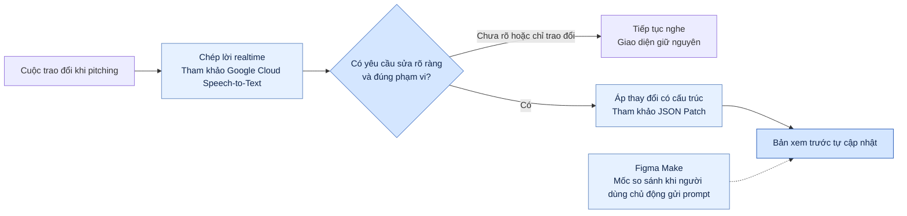

# Báo cáo nhóm — Day 02 Discovery & Problem Framing

> Bản chung của nhóm, viết trên repo do nhóm trưởng fork. Không copy file này sang repo cá nhân.
> Template chi tiết và prompt mẫu: [docs/01-worksheet.md](../../docs/01-worksheet.md). Bài mẫu: [docs/02-deliverable-example.md](../../docs/02-deliverable-example.md).

## 1. Thông tin nhóm

- Tên nhóm: Delta
- Thành viên: xem `TEAM.md`
- Đề tài đã chọn: Cập nhật MVP realtime.
- Candidate problem được chọn (1 câu): Khi khách góp ý trong buổi pitching, nhóm chưa thể cập nhật giao diện ngay, nên phải chỉnh sửa nội bộ rồi hẹn thêm buổi để trình bày lại.
- Quyết định cuối: Go / Not Yet / No-Go

---

## 2. Hội tụ nhóm (CP3)

### 2.1. Pitch

| # | Người đưa ra | Candidate (Job Story ngắn) | Actor | Bottleneck | Câu hỏi phản biện nhận được (ai hỏi) |
|---:|---|---|---|---|---|
| 1 | | | | | |
| 2 | | | | | |
| 3 | | | | | |
| 4 | | | | | |
| 5 | | | | | |
| 6 | | | | | |
| 7 | | | | | |
| 8 | | | | | |
| 9 | | | | | |
| 10 | | | | | |
| 11 | | | | | |
| 12 | | | | | |

### 2.2. Cluster

| Cluster | Các candidate | Pattern chung |
|---|---|---|
| A | | |
| B | | |
| C | | |

### 2.3. Opportunity Solution Tree rút gọn

Gốc là **1 outcome**. Nhánh là **opportunity** (nhu cầu, pain), không phải tính năng hay công cụ.

```text
OUTCOME: 
├── Opportunity A: 
├── Opportunity B: 
└── Opportunity C: 
```

Những ý đã gạch bỏ vì là solution đội lốt opportunity:

-

### 2.4. Chấm điểm shortlist (1–5)

| Candidate | Actor rõ | Quy trình rõ | Pain có bằng chứng | Impact đo được | Vừa sức lab | So sánh được No AI/Rule/Workflow/Agent | Nhóm hiểu domain | Tổng |
|---|---:|---:|---:|---:|---:|---:|---:|---:|
| | | | | | | | | |
| | | | | | | | | |
| | | | | | | | | |

**Candidate được chọn:** Các vòng chỉnh sửa giao diện MVP sau khi khách góp ý trong buổi pitching (Problem Card #2 của Hiếu). Nhóm chốt hướng tìm hiểu cập nhật MVP realtime.

**Vì sao chọn:**

**Vì sao loại các candidate còn lại:**

**Xử lý bất đồng (nếu có):**

---

## 3. Kiểm chứng + research giải pháp đã có (CP4)

### 3.1. Assumption Map

| # | Giả định | Loại (Value / Usability / Feasibility / Viability) | Quan trọng (1–5) | Đã có bằng chứng (1–5) | Kiểm chứng trước? |
|---:|---|---|---:|---:|---|
| 1 | | | | | |
| 2 | | | | | |
| 3 | | | | | |
| 4 | | | | | |
| 5 | | | | | |
| 6 | | | | | |

*Điền 4–6 giả định; xóa dòng thừa.*

Giả định nhóm kiểm chứng trong buổi này:

### 3.2. Kiểm chứng

Cách đã dùng: Phỏng vấn / Survey / Log, ticket, review

Interview snapshot (mỗi buổi phỏng vấn một bảng, hoặc đặt file trong `report/assets/cp4-interview-snapshot-N.md`):

| Trường | Nội dung |
|---|---|
| Người được hỏi (vai trò, không ghi tên thật) | |
| Câu nói đáng nhớ nhất (nguyên văn) | |
| Lần gần nhất gặp vấn đề này: chuyện gì đã xảy ra? | |
| Hiện đang xử lý bằng cách nào (workaround)? | |
| Mất bao lâu, bao lần? | |
| Insight / opportunity rút ra | |

Tổng hợp:

| Nguồn | Số người / số mẫu | Tín hiệu xác nhận | Tín hiệu phản bác |
|---|---:|---|---|
| | | | |

**Nhóm đã sửa problem thế nào sau kiểm chứng:**

### 3.3. Research giải pháp đã có

| Công cụ / case / pattern | Link | Giải bước nào trong quy trình? | Điểm mạnh | Khoảng trống / rủi ro | Bài học cho nhóm |
|---|---|---|---|---|---|
| Google Cloud Speech-to-Text | [Streaming recognition](https://docs.cloud.google.com/speech-to-text/docs/streaming-recognize) và [kết quả tạm thời, kết quả cuối](https://docs.cloud.google.com/speech-to-text/docs/v1/speech-to-text-requests#streaming_speech-to-text_api_recognition_requests) | Chuyển lời nói trong buổi pitching thành văn bản. | Trả kết quả trong lúc nhận âm thanh và phân biệt bản chép tạm với kết quả cuối. | Văn bản chưa cho biết câu nào là yêu cầu sửa. Kết quả tạm có thể thay đổi khi người nói nói tiếp. | Chỉ đưa đoạn nhận dạng cuối vào bước phân loại yêu cầu. Đo độ trễ từ lúc người nói kết thúc câu đến lúc giao diện đổi. |
| Figma Make | [Chỉnh sửa tệp Figma Make](https://help.figma.com/hc/en-us/articles/42009840449175-Edit-a-Figma-Make-file) và [FAQ](https://help.figma.com/hc/en-us/articles/31722591905559-Figma-Make-FAQs) | Dùng prompt hoặc công cụ chỉnh sửa để thay đổi bản xem trước. | Tài liệu mô tả cập nhật preview khi người dùng gửi prompt và có hỗ trợ nhập prompt bằng giọng nói. | Luồng được tài liệu mô tả bắt đầu từ một prompt hoặc thao tác chỉnh sửa có chủ đích. Nguồn chưa xác nhận khả năng tự phát hiện yêu cầu trong cuộc hội thoại rồi áp dụng ngay. | Dùng làm mốc so sánh với phương án có người nhập yêu cầu. Thử xem tự nhận yêu cầu có giảm thao tác mà vẫn giữ đúng ý khách hay không. |
| JSON Patch (RFC 6902) | [RFC 6902, mục 4–5](https://www.rfc-editor.org/rfc/rfc6902.html#section-4) | Áp thay đổi có cấu trúc lên trạng thái bản xem trước nếu giao diện biểu diễn được bằng JSON. | Cho phép sửa đúng trường và kiểm tra giá trị hiện tại trước khi áp dụng. | Chuẩn chỉ mô tả thao tác trên dữ liệu. Nhóm vẫn cần ánh xạ yêu cầu nói thành phần tử giao diện, kiểm tra phạm vi và lưu bản trước khi sửa. | Thử trên một màn hình, với thao tác đổi nhãn hoặc vị trí nút đã định sẵn. Giữ bản trước để có thể khôi phục nếu kết quả sai ý. |

#### Sơ đồ khoảng trống cần thử nghiệm

Sơ đồ nối các bước tham khảo thành luồng đề xuất cho **một màn hình MVP**. Các công cụ trong bảng là nguồn đối chiếu cho từng bước.



**Điểm cần kiểm chứng.** Chuyển lời nói thành văn bản và áp thay đổi có cấu trúc là hai bước có tài liệu tham khảo. Phần cần thử là liệu hệ thống có nhận đúng **ý định sửa giao diện trong cuộc trao đổi tự nhiên** và áp dụng đủ nhanh để bản sửa xuất hiện ngay trong lúc pitching.

**Tình huống để bàn giao cho CP5–CP6**

- **Yêu cầu rõ:** Khách nói “Đưa nút Đặt lịch lên đầu màn hình”. Bản xem trước tự đổi đúng vị trí. Đo từ lúc khách nói xong đến lúc nút xuất hiện ở vị trí mới.
- **Trao đổi thông thường:** Khách hỏi “Nút Đặt lịch hiện nằm ở đâu?”. Giao diện giữ nguyên.
- **Yêu cầu mơ hồ:** Khách nói “Chỗ này nhìn chưa ổn”. Công cụ tiếp tục nghe cho đến khi xác định được phần tử và thay đổi cụ thể.

**Bàn giao kiểm thử.** [Bộ 20 tình huống cho bản thử](../assets/cp4-bo-tinh-huong-mvp.md) có trạng thái ban đầu, kết quả mong đợi và mẫu ghi thời gian. Số liệu kiểm thử sẽ được điền khi nhóm có bản chạy thực tế.

**Đối chiếu số liệu trước khi chốt baseline**

- [Problem Card #2 của Hiếu](../individual/2A202603993_CaoTrungHieu.md#problem-card-2) ghi khoảng **15–20 phút trao đổi lại và cập nhật mỗi vòng**, khoảng 2–3 vòng mỗi MVP. Tổng **30–60 phút** ở đó chỉ tính phần trao đổi theo vòng.
- [Slide Vấn đề](../cac-vong-chinh-sua-mvp.html#slide-2) dùng ước tính khoảng **2 giờ cho toàn bộ một buổi pitching**, 2–3 buổi mỗi MVP, tức **4–6 giờ họp**. Con số **6–9 giờ** chỉ áp dụng nếu nhóm dành thêm khoảng **1 giờ chỉnh sửa nội bộ sau mỗi buổi**.
- Ở mục 3.2, ghi riêng tổng thời lượng buổi họp, số phút dành riêng cho việc làm rõ phản hồi, và số lần thực sự phải chỉnh sửa sau họp. Khi tính tổng, cộng thời lượng họp với thời gian chỉnh sửa nội bộ thực tế. Thời gian trao đổi đã nằm trong buổi họp cần được ghi riêng để tránh cộng hai lần.

---

## 4. Quy trình trước/sau (CP5)

### 4.1. Quy trình hiện tại

Sơ đồ (ASCII, Mermaid hoặc link ảnh trong `report/assets/`):

```text

```

| Bước | Actor | Input | Output | Thời gian / tần suất | Ghi chú |
|---:|---|---|---|---|---|
| 1 | | | | | |
| 2 | | | | | |
| 3 | | | | | |
| 4 | | | | | |
| 5 | | | | | |

**Bottleneck chính:**

### 4.2. Quy trình tương lai

Ghi rõ bước nào **Rule**, bước nào **AI**, bước nào **con người**, **boundary** ở đâu, **phương án quay về** khi AI sai.

```text

```

### 4.3. Before / after

| Chỉ số | Trước | Sau (kỳ vọng) | Ghi chú |
|---|---:|---:|---|
| Số bước | | | |
| Tổng thời gian | | | |
| Số bước thủ công | | | |
| Bottleneck chính | | | |
| Rủi ro mới phát sinh | | | |

---

## 5. Problem Statement v0 (CP5)

| Trường | Nội dung |
|---|---|
| **Actor** | |
| **Quy trình** | |
| **Bottleneck** | |
| **Impact** | |
| **Success Metric** (baseline → target, cách đo) | |
| **Boundary** (AI không được làm gì; khi nào cần con người kiểm tra — HITL) | |

Phản biện nhận được (từ AI hoặc nhóm khác) và nhóm có đồng ý không:

-

---

## 6. Mức can thiệp AI (CP6)

### 6.1. Ma trận độ mơ hồ × độ phức tạp

Bài của nhóm nằm ở ô:

Vì sao:

### 6.2. So sánh 4 mức

| Mức | Phương án cho bài của nhóm | Đủ khi nào | Rủi ro | Chọn? |
|---|---|---|---|---|
| **No AI** (sửa quy trình) | | | | |
| **Rule** | | | | |
| **Workflow** | | | | |
| **Agent** | | | | |

**Mức chọn:**

**Vì sao không chọn mức đơn giản hơn:**

### 6.3. AI Canvas rút gọn

| Thành phần | Nội dung |
|---|---|
| **Prediction** — AI dự đoán / tạo ra gì? | |
| **Judgment** — con người cân nhắc, quyết định gì? | |
| **Action** — hành động cuối cùng là gì, ai làm? | |
| **Outcome** — đo kết quả bằng gì? | |
| **Input** — AI cần dữ liệu đầu vào gì mỗi lần chạy? Có sẵn không? | |
| **Feedback** — lấy phản hồi ở đâu để cải thiện? | |

### 6.4. Hai câu hỏi của Google PAIR

- Người dùng muốn **được hỗ trợ (augment)** hay **giao hẳn việc (automate)**? Bằng chứng:
- AI sai kiểu nào tệ hơn, **báo nhầm** hay **bỏ sót**? Vì sao, và thiết kế đã xử lý thế nào:

---

## 7. Problem Statement v1 + tiêu chí đánh giá (CP6)

| Trường | Nội dung |
|---|---|
| **Actor** | |
| **Quy trình** | |
| **Bottleneck** | |
| **Impact** | |
| **Success Metric** (baseline → target, cách đo) | |
| **Boundary** | |
| **AI intervention point** | |
| **Mức chọn** | No AI / Rule / Workflow / Agent |
| **Rủi ro & người kiểm tra** | |

**Thay đổi so với v0 và lý do:**

| Trường | v0 | v1 | Vì sao đổi |
|---|---|---|---|
| | | | |

**Tiêu chí đánh giá đầu ra của AI (3–5 tiêu chí):**

| # | Tiêu chí | Đạt khi | Không đạt khi |
|---:|---|---|---|
| 1 | | | |
| 2 | | | |
| 3 | | | |

---

## 8. Quyết định (CP6)

### 8.1. Bốn rủi ro

| Rủi ro | Câu hỏi | Mức độ rủi ro (Thấp = an toàn / TB / Cao = nguy hiểm) | Lý do / bằng chứng |
|---|---|---|---|
| **Value** | Người dùng có thật sự cần và sẽ dùng không? | | |
| **Usability** | Người dùng có dùng được, có hiểu và sửa được đầu ra của AI không? | | |
| **Feasibility** | Có đủ dữ liệu, công cụ, kỹ năng để làm không? | | |
| **Viability** | Có hợp chi phí, pháp lý, quy định tổ chức không? Ai vận hành? | | |

### 8.2. Kết luận

**Quyết định:** Go / Not Yet / No-Go

**Lý do:**

**Nếu Go — pilot nhỏ nhất:**

**Nếu Not Yet — cần kiểm chứng gì trước:**

**Nếu No-Go — nên làm gì thay AI:**

**Ngưỡng dừng** (nếu sau … mà … thì quay về …):

---

## 9. Hạn chế và hướng tiếp theo

-

## 10. Tài liệu tham khảo

-
